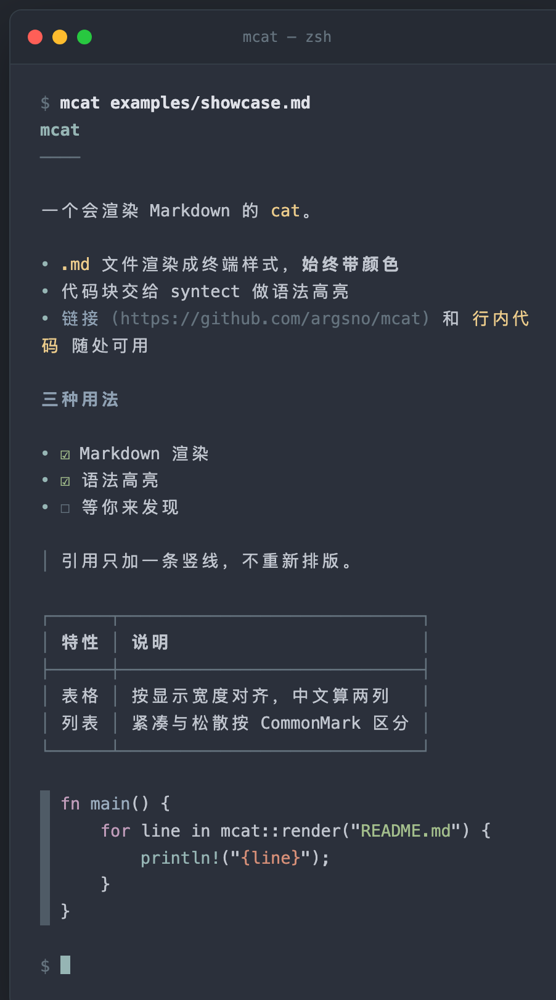
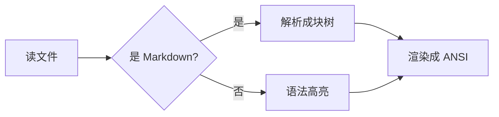

<div align="center">
  <picture>
    <source media="(prefers-color-scheme: dark)" srcset=".github/readme/banner-dark.svg">
    
  </picture>

  <p><strong>一个会渲染 Markdown 的 <code>cat</code></strong></p>

  <p>
    <a href="https://github.com/argsno/mcat/releases"></a>
    <a href="https://github.com/argsno/mcat/blob/main/LICENSE"></a>
    
    <a href="https://github.com/argsno/mcat/actions/workflows/release.yml"></a>
    <a href="https://github.com/argsno/mcat/stargazers"></a>
  </p>

  
</div>

看 Markdown、看代码、看图，一个命令。输出始终带颜色，行为和 `cat` 一致：
多个文件依次输出、读标准输入、`-` 表示标准输入、读不了的文件报错后继续。

## 三种用法

| | 命令 | 说明 |
|---|---|---|
| **Markdown 渲染** | `mcat README.md` | 标题分级配色、列表、引用、表格、任务清单、脚注，按 CommonMark 渲染 |
| **语法高亮** | `mcat src/main.rs` | 代码块和其他源码文件按语言上色，[bat](https://github.com/sharkdp/bat) 的语法集 + [syntect](https://github.com/trishume/syntect) 主题，纯 Rust 后端；默认跟随终端明暗 |
| **看图** | `mcat examples/gradient.png` | Kitty 图形协议 / iTerm2 内联图片，图片直接画在终端里；认文件内容，不认扩展名 |

```console
$ mcat --image-rows 12 shot.jpg   # 限制图片高度
$ git log -p | mcat               # 标准输入按 Markdown 处理
$ curl … | mcat -l json           # 强制指定语言
$ mcat --no-render README.md      # 完全等同 cat
```

## mermaid 图

` ```mermaid ` 代码块直接画成图，和图片走同一条链路：Kitty / iTerm2 图形协议，
[纯 Rust 渲染](https://github.com/Latias94/merman)，不需要 Node.js。



图的明暗配色默认跟着终端背景走：先问终端要背景色（OSC 11），问不到再读 `COLORFGBG`，
都没有就按亮色。要固定配色用 `--mermaid-theme light` 或 `dark`。图的底色是透明的，
不会在深色终端里变成一块白方块。画不出来（协议不支持、源码有语法错、图类型 merman
不支持）就退回显示源码，不报错。

## 配置文件

默认值可以写进 TOML 配置文件，命令行里显式给出的参数永远优先：

```toml
# ~/.config/mcat/config.toml
theme = "auto"
mermaid_theme = "dark"
image_rows = 16
numbers = true
no_color = false
```

| 键 | 对应参数 |
|---|---|
| `theme` | `--theme` |
| `mermaid_theme` | `--mermaid-theme` |
| `image_protocol` | `--image-protocol` |
| `image_rows` | `--image-rows` |
| `image_cols` | `--image-cols` |
| `numbers` | `--numbers` |
| `no_color` | `--no-color` |
| `no_images` | `--no-images` |

`theme` 默认是 `auto`：深色终端用 `mcat-dark`，浅色终端用 `mcat-light`。`mcat --list-themes`
列出所有可选主题。

键名写成连字符（`image-rows`）也认。布尔项写 `true` 或 `false`；配置里打开的开关，
命令行可以用反义参数关掉：`--no-numbers`、`--color`、`--images`。

配置文件按这个顺序找，找到第一个就用：

1. `--config <FILE>`
2. `$MCAT_CONFIG`
3. `$XDG_CONFIG_HOME/mcat/config.toml`（没设 `XDG_CONFIG_HOME` 时是 `~/.config/mcat/config.toml`）

前两个是显式指定的，文件不存在会报错；默认路径不存在就静默跳过。
这次调用要做什么（文件列表、`--language`、`--no-render`、`--list-themes`、`--check-images`）
不能写进配置。完整的示例见 [examples/config.toml](examples/config.toml)。

## 输出长什么样

- **始终带颜色**，重定向到文件也是——产物是给人看的。要纯文本用 `--no-render`（完全等同 `cat`），
  要无色排版用 `--no-color`。
- **正文不折行**，和 `cat` 一致；块之间固定留一个空行，一级标题下补一条等宽横线。
  **表格例外**：比终端宽的表格会压窄列、把单元格内容折行，框线始终对齐；管道和重定向里不折。
- **正文配色只用终端的 16 个基础色**，跟着你的调色板走；语法高亮用真彩色输出。
  `--theme auto`（默认）按终端背景选 `mcat-dark` / `mcat-light`，也可以用 `--theme` 强制指定。
- **Markdown 代码块左边是一列背景色色条**，内容仍然缩进两格。色条是背景色而不是字符，
  选中复制代码块时只有原来的两个前导空格。单独看源码文件不加色条，保持顶格。
- **语言先按整个文件名认，再按扩展名**：`Dockerfile`、`Makefile`、`.gitignore` 这类没有扩展名的
  文件也能上色；还认不出就看首行 shebang，`-l` 可以强制指定。
- **表格按显示宽度对齐**（中文、全角和整簇 emoji 都算两列），表头加粗。
- `-n` 数的是输出行。渲染会重排块，数字和源文件对不上——和 `cat -n` 的行为一致。
- 不是合法 UTF-8 的文件原样输出，不做渲染。

## 安装

```console
$ brew install argsno/tap/mcat
```

预编译二进制，支持 macOS（arm64 / Intel）和 Linux（x86_64 / arm64）。也可以用 cargo 自己编译：

```console
$ cargo install --git https://github.com/argsno/mcat
```

## FAQ

**和 cat 有什么区别？**

cat 输出字节流，mcat 输出渲染后的样式给人看。要字节流时用 `--no-render`，那时它完全等同 cat。

**为什么重定向到文件还带颜色？**

有意的——样式随文件一起保留。要纯文本用 `--no-render`，要无色排版用 `--no-color`。

**图片没显示出来？**

用 `mcat --check-images` 排查：不输出正文，把协议从哪猜的、文件找没找到、格式、最终占多少
字符格、载荷多大，一路打出来。mermaid 图也一起查。任何一环走不通都退回文字占位，不会报错。

**mermaid 图为什么没画出来？**

`--check-images` 会报出卡在哪一步：图类型认不认得、SVG 出没出、光栅化有没有失败。
多数情况是 stdout 不是终端（管道、重定向），或者终端不支持图形协议——这时图退回源码。
配色不对用 `--mermaid-theme auto`、`light` 或 `dark` 固定。

**哪些终端能画图？**

| 协议 | 终端 | 备注 |
|---|---|---|
| Kitty 图形协议 | Ghostty、kitty、WezTerm、foot、Contour | 只认 PNG，其他格式转码 |
| iTerm2 内联图片 | iTerm2、WezTerm、VS Code | 原始字节交给终端解码，不转码 |

协议从环境变量猜（`TERM_PROGRAM`、`KITTY_WINDOW_ID` 等），可以用 `--image-protocol` 强制。
支持 PNG、JPEG、GIF、WebP、BMP；远程图片有 24 小时缓存。标准输入不参与图片识别——
`git log -p | mcat` 的行为不会变。

**为什么 -n 的行号和源文件对不上？**

它数的是输出行。Markdown 渲染会重排块（加横线、插空行），这和 `cat -n` 数输出行的行为是一致的。

## 开发

自己编译的步骤、代码结构、实现取舍见 [CONTRIBUTING.md](CONTRIBUTING.md)。

---

<div align="center">

**不重新排版，只上样式。**

</div>
